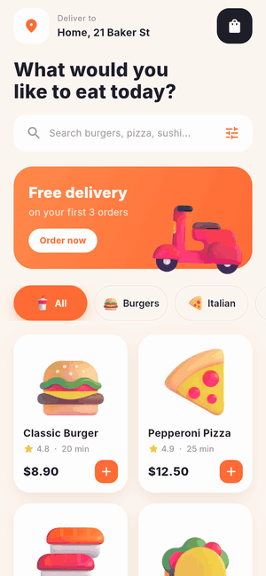

# Bitely: Animated Food Delivery App in Flutter (No Packages)

Source code for the YouTube tutorial on the **Orhan Yazdan** channel:
**Build an Animated Food Delivery App in Flutter**: https://www.youtube.com/@orhanyazdan



## What's inside

Four screens and a dozen animations, all in plain Flutter:

- **Home**: staggered entrance (`TweenAnimationBuilder` + `Interval`), a bobbing scooter banner, and a sliding category pill (`AnimatedPositioned` + `Curves.easeOutBack`)
- **Food grid**: cards fade in one by one and replay when you switch category
- **Fly to cart**: the food flies along a curve into the cart (`Overlay` + quadratic Bezier), and the badge pops (`Curves.elasticOut`)
- **Detail screen**: `Hero` transition, a floating dish, an S/M/L selector (`AnimatedAlign`), a quantity stepper (`AnimatedSwitcher`) and a counting price
- **Cart**: swipe to delete (`Dismissible`) with live totals
- **Live tracking**: a scooter that follows a dashed road (`PathMetric.getTangentForOffset`) and a step timeline
- **State**: one `ChangeNotifier` cart shared with an `InheritedNotifier`

## Files

```
lib/
  main.dart                theme.dart
  data/      food.dart  cart.dart
  screens/   home_screen.dart  detail_screen.dart  cart_screen.dart  tracking_screen.dart
  widgets/   fade_slide.dart  promo_banner.dart  category_chips.dart  food_card.dart
             fly_to_cart.dart  cart_button.dart  size_selector.dart  qty_stepper.dart
             animated_price.dart  route_map.dart
```

## Run it

```bash
git clone https://github.com/KamranAmin786/bitely_delivery-app.git
cd bitely_delivery-app
flutter pub get
flutter run
```

Tested with Flutter 3.47 (Dart 3.9+). Works on Android, iOS and web.

## Credits

- Food pictures: [Fluent Emoji](https://github.com/microsoft/fluentui-emoji) by Microsoft (MIT License)
- Font: [Inter](https://rsms.me/inter/) by Rasmus Andersson (SIL Open Font License 1.1)

If this helped you, subscribe to the channel for more Flutter UI and animation tutorials.
